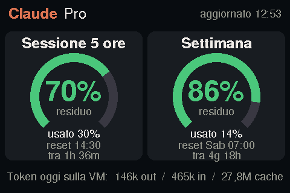
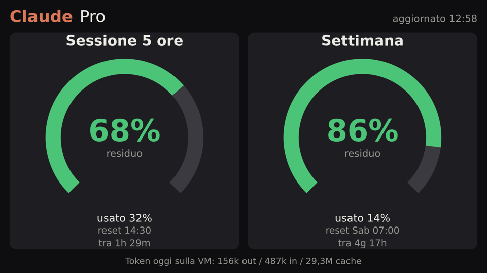

# Claude Meter

Piccolo display da scrivania che mostra quanto resta dei limiti del piano Claude (Pro/Max):
il limite di **sessione (5 ore)** e quello **settimanale**, con l'orario del reset.
Gira su una scheda ESP32-S3 con schermo da 3,5" (WT32-SC01 Plus). La stessa grafica è
disponibile anche come pagina web, da mettere su un kiosk o in una scheda del browser.

| ESP32 (480x320) | Pagina web (1920x1080) |
|---|---|
|  |  |

## Come funziona

```
api.anthropic.com/api/oauth/usage  <--(ogni 5 min)--  usage_server.py  --(:8790)-->  /usage.json  <-- ESP32 (ogni 60 s)
        (token OAuth di Claude Code)                    (macchina con                /            <-- browser/kiosk
                                                         Claude Code)
```

- **`usage_server.py`**: un solo file Python, senza dipendenze esterne (Python 3.9 o superiore). Gira sulla macchina dove hai fatto
  il login di Claude Code. Ogni 5 minuti legge l'utilizzo del piano e lo serve in LAN:
  - `GET /usage.json`: percentuali usate e residue, orari e countdown dei reset, token di oggi;
  - `GET /`: la pagina web.
  Il token **non** viene mai esposto: nel JSON ci sono solo percentuali e orari.
- **Firmware `fw/`** (PlatformIO, Arduino, LovyanGFX, WiFiManager, ArduinoJson): legge `/usage.json`
  e disegna due anelli con il residuo (verde sopra il 50%, ambra sopra il 20%, rosso sotto).

## Da dove viene il dato (e quanto è affidabile)

- **Percentuali dei limiti**: vengono da `https://api.anthropic.com/api/oauth/usage`, l'endpoint che
  usano `/usage` di Claude Code e la pagina utilizzo delle app. **Non è documentato né supportato**
  da Anthropic: può cambiare senza preavviso o rispondere con 429. Per questo il server lo interroga
  solo ogni 5 minuti e dopo un 429 aspetta 15 minuti. I valori coincidono con quelli dell'app e
  comprendono tutto l'uso dell'account (chat, Claude Code, altri dispositivi).
- **Autenticazione**: il server legge il token OAuth da `~/.claude/.credentials.json` e non lo
  rinnova mai da solo. Se il token sta per scadere lancia `claude auth status`, che lo rinnova con
  la logica di Claude Code.
- **Token di oggi** (riga in basso): somma del campo `message.usage` nei transcript locali
  `~/.claude/projects/**/*.jsonl`. Conta solo Claude Code su quella macchina e si basa su un
  formato osservato, non documentato. Anthropic non pubblica il limite del piano in token, quindi un
  "residuo in token" non si può calcolare.
- **Alternativa documentata**: la [status line di Claude Code](https://code.claude.com/docs/en/statusline)
  riceve `rate_limits.five_hour` / `rate_limits.seven_day` (`used_percentage`, `resets_at`), ma
  solo dentro una sessione interattiva da terminale.

## Server

```bash
python3 usage_server.py            # porta 8790 (CUD_PORT per cambiarla)
curl http://localhost:8790/usage.json
```

Per tenerlo sempre attivo senza root (cron + flock: una sola istanza, riparte da solo):

```bash
(crontab -l; echo '* * * * * $HOME/claude-usage-display/run-server.sh') | crontab -
```

In alternativa va bene un servizio systemd utente (con `loginctl enable-linger`).

## Firmware (WT32-SC01 Plus)

Pin: bus 8080 a 8 bit (WR 47, DC 0, D0-D7 9/46/3/8/18/17/16/15, RST 4), retroilluminazione 45,
touch FT6336U su I2C (SDA 6, SCL 5, INT 7).

```bash
cd fw
cp local.ini.example local.ini      # metti l'URL del tuo server
pio run -t upload
```

- Al primo avvio la scheda apre la rete **`ClaudeMeter-setup`**. Collegati, apri `http://192.168.4.1`,
  scegli la rete a 2,4 GHz e inserisci la password: resta salvata solo sulla scheda.
  Dal portale si può cambiare anche l'URL del server.
- **Tocco breve**: aggiorna subito. **Pressione di 6 s** (oppure tocco durante l'avvio): riapre il portale Wi-Fi.
- `http://<ip-scheda>/`: stato in JSON. `http://<ip-scheda>/screen.bmp`: copia dello schermo.
- Se il reset arriva prima di un nuovo dato, l'anello torna da solo al 100%. Se il server non
  risponde, gli anelli diventano grigi.

### Wi-Fi robusto

- Si collega sempre al nodo con il segnale più forte tra quelli con lo stesso SSID (utile con le
  reti mesh): l'ESP32 di serie prende il primo che trova, anche se lontano.
- All'avvio riprova la rete salvata 3 volte prima di aprire il portale, che poi si chiude dopo
  5 minuti e la scheda riprova.
- Se resta senza Wi-Fi per 5 minuti si riavvia. Se il segnale resta sotto −80 dBm per 5 minuti
  cerca un nodo migliore (al massimo ogni 30 minuti). Watchdog hardware sul loop.
- Con segnale sotto −75 dBm lo schermo mostra in basso SSID, dBm e canale.
- `http://<ip-scheda>/` riporta anche `ssid`, `bssid`, `channel`, `disconnects`, `last_disc_reason`
  (codice `wifi_err_reason_t`), `roams` e `reset_reason`.

### Aggiornamento via Wi-Fi (facoltativo)

Definisci `OTA_PASSWORD` e l'ambiente `ota` in `local.ini` (vedi `local.ini.example`), carica una
volta via USB, poi:

```bash
pio run -e ota -t upload
```

## Licenza

MIT. Progetto non ufficiale, non affiliato ad Anthropic.
